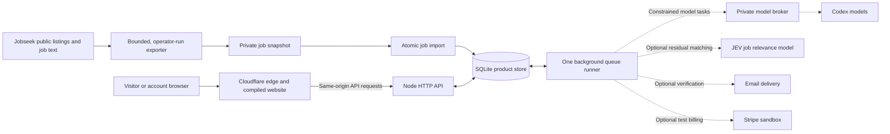

# How the service fits together

Justup has one website and one product backend. The diagram shows the boundaries implemented in this repository and the [deployment design](deployment-plan.md), not a claim that every connection is enabled. The table below describes the same paths for readers who cannot use the diagram.

Solid lines show built data and request paths. Dashed lines show external calls that need their own configuration and qualification before use. In the deployment design, Cloudflare serves the compiled site and forwards `/api/v1` requests to the backend on isolated Hetzner capacity. The edge does not store account records or contain model credentials.

## What each part does

| Part | Role and owning guide |
| --- | --- |
| Jobseek public source and exporter | The [job import guide](job-data.md) describes a bounded, read-only export of public listing fields and normalized job text. An operator reviews the private snapshot before import; the exporter neither changes Jobseek nor starts a schedule. |
| Website and edge | The [web application](../web/README.md) presents public jobs, search workspaces, company pages and account controls. The [frontend delivery guide](frontend-delivery.md) owns compiled assets, edge routing and verification. Browser code does not contact model or billing providers directly. |
| HTTP API | This is the server interface called by the website. The [API guide](api.md) owns sessions, access checks, searches, companies and public reads. The API does not run model tasks or hold outbound model and payment keys. |
| Product store | The [schema guide](schema.md) owns SQLite, Justup's local database. It holds imported job evidence, accounts, searches, company requests, queued tasks and published editions; import and deletion use explicit consistency boundaries. |
| Background runner | The [server guide](../server/README.md) and [operations guide](operations.md) describe the single worker that leases recorded tasks, checks current access again and writes accepted results. It handles interactive and scheduled work without a second product database. |
| Model broker | The [model guide](models.md) describes the separate, restricted process that can run Codex tasks for search interpretation, company resolution and weekly Hiring Wire work. Only the runner may ask it for work; the API and broker do not share database access. |
| JEV job relevance model | The [matching guide](matching.md) owns this optional second-stage filter after ordinary job filters. The runner needs an approved provider key, a separate cumulative allowance ledger and measured qualification before calling it. |
| Email and Stripe | [Account verification](account-verification.md) uses queued email work; [test billing](account-billing.md) uses an isolated Stripe sandbox adapter. Both default off. Source code alone does not enable real email delivery or live payments. |

## Follow two common paths

**A job reaches a reader:** the explicit exporter reads bounded public Jobseek data and writes a private snapshot. The import command checks and commits that snapshot into SQLite. The API applies source freshness and account access rules before the website shows a listing. A browser read cannot refresh missing evidence or turn an unavailable source into a confirmed empty result. [Continuous source refresh](job-data.md#refresh-and-removal) still needs its source, scheduling and recovery integration.

**A search request returns results:** the website sends a request to the API, which checks ownership and processing availability and records the search and any required task. The single runner leases the task; qualified model work goes through the private broker. Ordinary filtering runs before optional JEV matching. The API reads the stored result with current access checks and returns it to the website. [Search and matching](backend-design.md#4-search-delivery-and-ai-filtering) and [live result delivery](live-results.md) explain the detailed contracts.

Company requests use the same API, store and runner. A model may help resolve an unclear company identity, but the user must confirm a candidate before it becomes an accepted request; acceptance does not itself prove that monitoring has started. See [company requests](backend-design.md#5-companies-and-requests) and [source coverage](source-coverage.md).

## What source presence does not prove

The importer currently runs only when an operator invokes it; continuous source delivery and attributable coverage history still need end-to-end qualification. Model profiles and provider adapters have built contracts, but need the relevant identity, policy, spend and host checks before external calls. The Cloudflare and Hetzner placement describes how the same product is deployed, while [release verification](development-process.md#6-verify-a-release-before-it-goes-live) determines when an exact candidate can serve invited users. A published website alone is not evidence that its API, providers or data pipeline are ready.
